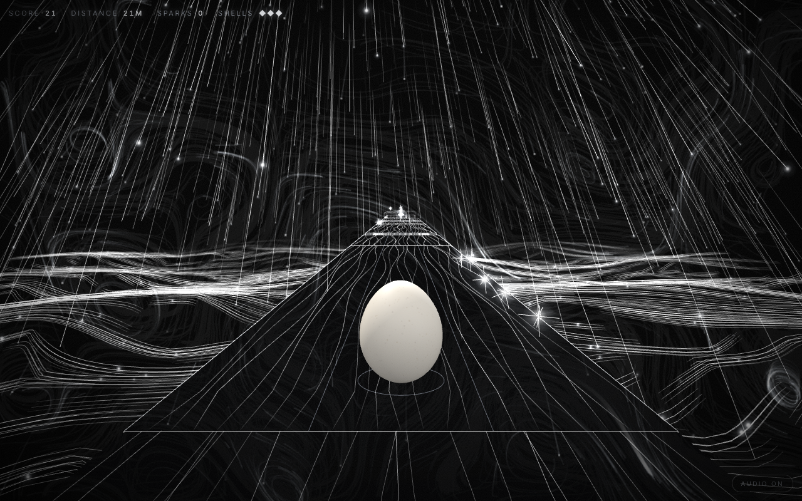
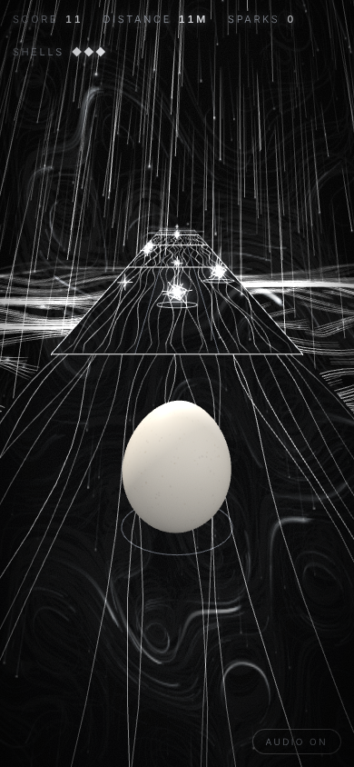

# Eggscape the Storm

It has been raining light for a week.

A 3D runner-platformer in the browser: roll east down a course that builds
itself, jump the holes, dodge the bolts coming down out of the sky, take the
sparks.

The egg is [Marc's](https://github.com/h1ddenpr0cess20/marc), as he is — the
same 128×96 shell through the same `shapeEgg` profile, the same 900-speckle
cream skin, the same physical material with its clearcoat and sheen, lit by his
studio rig with one cold light added for the storm. Everything else out here is
light on black, silver and white and nothing else. He is the only warm thing
left in it, which is the point.



## Run

```sh
git clone https://github.com/h1ddenpr0cess20/eggscape-iv
cd eggscape-iv
npm install
npm run dev               # → http://localhost:5173
```

No API keys, no server, no account, and no libraries: it is a static page with
its own renderer, drawing with WebGPU or WebGL 2.

## Play

| | |
|---|---|
| `A` `D` / `←` `→` | one lane, per press |
| `W` / `↑` / `space` | jump — again in the air for a flip |
| `S` / `↓` | slam down — onto a bolt to break it |
| `M` | audio |

On a phone: swipe for a lane, flick up to jump, flick down to slam, tap for a
jump.

Three shells. A bolt costs one, so does the void, and either way the egg is
put back down and keeps going until the last one. A metre is a point, a spark
is twenty-five, and a bolt you come down on — in the air, slam on — is sixty
and one fewer bolt. Speed climbs with distance, so the course gets harder
because you are getting faster, and the gaps grow to match.

Bolts fall. Every one you see further than forty metres off is still on its
way down, a knot of light with its tail behind it, and the ring it is going to
burn into the deck is there before it is. By the time it matters it has
landed, and it sits there crackling until you go round it, over it, or
through it with the slam on.

<p align="center">
  
</p>

## The weather

None of it touches the run. It follows the egg the way weather follows anybody
out in it, and it is all in `src/render/weather.js` and `src/render/sky.js`.

**The rain** is nearly three thousand streaks in a box that travels with the
egg. It is driven at the egg as well as down, and every streak is drawn as the
path it makes past the egg rather than past the ground — so on screen they all
fan out of one point high above the course, the way rain does when you look
up into it, and they lean harder the faster you run. Seven in ten carry a
glowing head; one in forty is near enough to bloom.

**The sea** is what the rain falls into, seven and a half metres under the course.
Threads are seeded on a grid fixed to the world, so it does not slide along
with you, and each is combed a dozen steps through the wind. A slow swell rolls
bright bands across it, and there are glints where the light lands.

**The wind** is one stream function, a handful of sines in `field.js`, and
everything is carried on its curl. Air that follows a curl never piles up or
thins out — it only goes round — so whatever rides on it gets pulled into long
threads and slow whorls, like smoke in water. The sky and the sea read the
same air. The curl is differentiated by hand, because it is asked
tens of thousands of times a frame.

**The sky** is a canvas stretched behind everything. Smoke is two thousand
threads, each a faint stroke a tick on a canvas that forgets slowly, and most
new threads start where an old one already is — so they follow it, and the
sky gathers into ribbons with black between them instead of filling in evenly
grey. The far rain is drawn fresh over a copy of it each tick, falling out of
the same vanishing point as the near rain. It is painted the way up the window
is, or a phone held upright would squeeze every whorl into a pillar.

**Lightning** strikes every few seconds, closer together the further you get,
and right beside you when you are hit. It is a fork by midpoint displacement
from the cloud to the sea, and it flickers the way lightning does — a stroke, a
gap, a return stroke, the long fade — lighting the sky from inside and turning
every light on the shell up at once. Thunder follows it by however far away it
was.

The road is a slab of black at well under half its opacity, with
threads of light combed down it like water and light running off every edge
into the dark. The lane lines are straight, and a little brighter than the
threads, so a lane is still a lane at speed.

## The soundtrack

There is no audio file in the repository, and there is music. `soundtrack.js`
writes it down — one token per sixteenth, `d2 - . d3+f3+a3` — and `music.js`
plays it on the same AudioContext the sound effects use, on instruments made
of oscillators and noise.

It is dark and driving and wet: a deep kick on every beat, a bass galloping on
the offbeats, and rain the whole way through, noise ticking on the sixteenths
loud and soft in no order a hand would choose. D minor, round Dm Dm Bb Bb Gm
Gm A A. The A is the storm — a major chord where the key wants a minor one, its
C sharp pulling hard back home, so the loop never quite settles before it
starts again.

It builds with distance. The first hundred metres are the kick, the bass and
the rain. Then come the hats, the crack on the backbeat and the drops — the
chord falling, three notes against four beats, mostly gaps — and at three
hundred the strings, a bell a long way up and thunder rolling once every eight
bars, and at six hundred the lead. Struck is a chord with no business in the
key and the power going; between runs it is the chords slowed right down, a
few drops, and thunder a long way off.

The thunder after a lightning strike is not in the score. It is `sound.js`,
three seconds of brown noise under a closing filter, put down on the audio
clock as far after the flash as the strike was away.

## How it holds together

It is built on the engine from
[Eggscape the Matrix](https://github.com/h1ddenpr0cess20/eggscape) — the same
core, the same renderer — and the run is a plain object graph with no pixels
in it: course, egg, lives, score. The renderer reads a snapshot of it every
frame. Nothing in `src/core/` touches the GPU or the DOM, which is why a seed
can be played out headlessly in a test and asserted on.

```
index.html            Markup only — Vite's entry
src/
  main.js             The wiring, and nothing else
  styles.css          The HUD, the vignette and the grain
  core/               The game. No GPU, no DOM, no randomness it did not seed
    game.js             Lives, score, pickups, and real seconds → fixed ticks
    course.js           The course, laid a pattern at a time, ahead of the egg
    player.js           Gravity, lanes, jump, coyote time, landings
    tuning.js           Every number the run is tuned by — the course reads it too
    shape.js            Marc's egg profile, verbatim
    rng.js              A seeded stream, so a seed is a course
    motion.js           The spring and the chase everything eases on
    emitter.js
  render/             The storm, built out of gpu/. Reads snapshots, owns no game state
    scene.js            Renderer, camera, fog, and the light for the egg
    view.js             Snapshot → scene graph, the chase camera, falling bolts, bursts
    weather.js          The rain, the sea, and the lightning
    sky.js              The smoke and the far rain, painted on a canvas
    field.js            The wind, and a hash
    sprites.js          Hundreds of glowing points in one draw
    streaks.js          Hundreds of fading lines in one draw
    glow.js             The one point of light they are all drawn with
    rig.js              Where the camera sits and what it looks at, as arithmetic
    egg.js              Marc, fitted to the collider
    shell.js            His geometry and material, carried over as they are
    skin.js             His speckled cream, painted onto a canvas
    environment.js      His studio, with the warmth taken out of the sky
    props.js            Slabs, bolts and sparks
    materials.js        Shared line materials
    theme.js            No colour at all
  gpu/                The renderer. Knows nothing about eggs
    renderer.js         Picks WebGPU or WebGL 2, and draws a scene with either
    frame.js            What is visible, in what order, and every uniform byte
    webgpu.js           The WebGPU backend
    webgl.js            The WebGL 2 backend
    …                   Geometry, materials, textures, the environment, shaders
  ui/
    hud.js              The readouts and the panel between runs
    input.js            Keys and swipes → one frame of intent
    sound.js            The arcade, and the thunder
    music.js            A sequencer that reads its parts out of strings
    soundtrack.js       The storm in D minor
    best.js             The only thing that survives a run
test/                 node:test, including an autopilot that proves seeds are fair
```

The generator never lays a gap wider than the jump that has to clear it, or a
step higher than the jump can rise: both come out of the same `tuning.js` the
physics uses, and the tests check every seed against them. Slabs never overlap
in z, so there is no wall to run into — miss a jump and you meet the void,
which is a fair thing to lose to.

A bolt's fall is only ever a picture. The run has it on the deck from the
moment the course is laid; the view draws it higher the further off it is and
has it down by forty metres, and `test/storm.test.js` checks that nothing is
still falling anywhere the egg could reach it.

`laneX` *descends* — lane 0 sits at the highest x — because the egg runs
towards +z and the camera chases it from behind, looking the same way, which
mirrors the picture: world +x draws on the left of the screen.
`test/rig.test.js` projects a lane through the real rig and checks which half
of the frame it lands on.

Everything that glows is drawn in two calls a frame: every point of light is a
quad in one buffer, squared up to the camera, and every streak is a line in
another, its bright end and its dark end carried as vertex colours and added
onto the black. Buffers never change size; what nobody asked for this frame is
folded to nothing.

| Script | |
|---|---|
| `npm run dev` | Vite |
| `npm run build` | Bundles to `dist/` |
| `npm run preview` | Serves the build |
| `npm test` | `node:test` over the core, the renderer, the storm, the HUD, the page and the music |
| `npm run lint` | ESLint |

CI runs the lint, the tests on Node 22.12 and 24, and a build that then has to
boot and serve itself.
